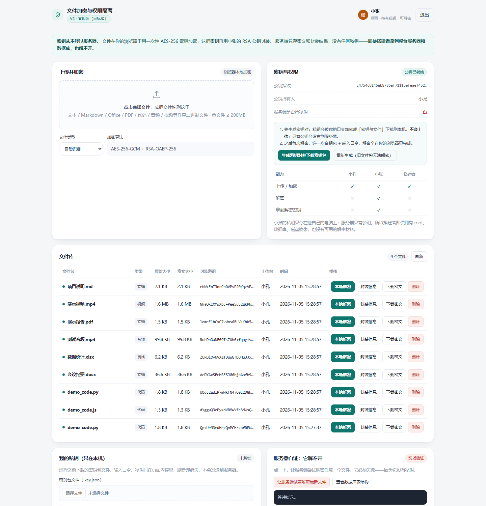
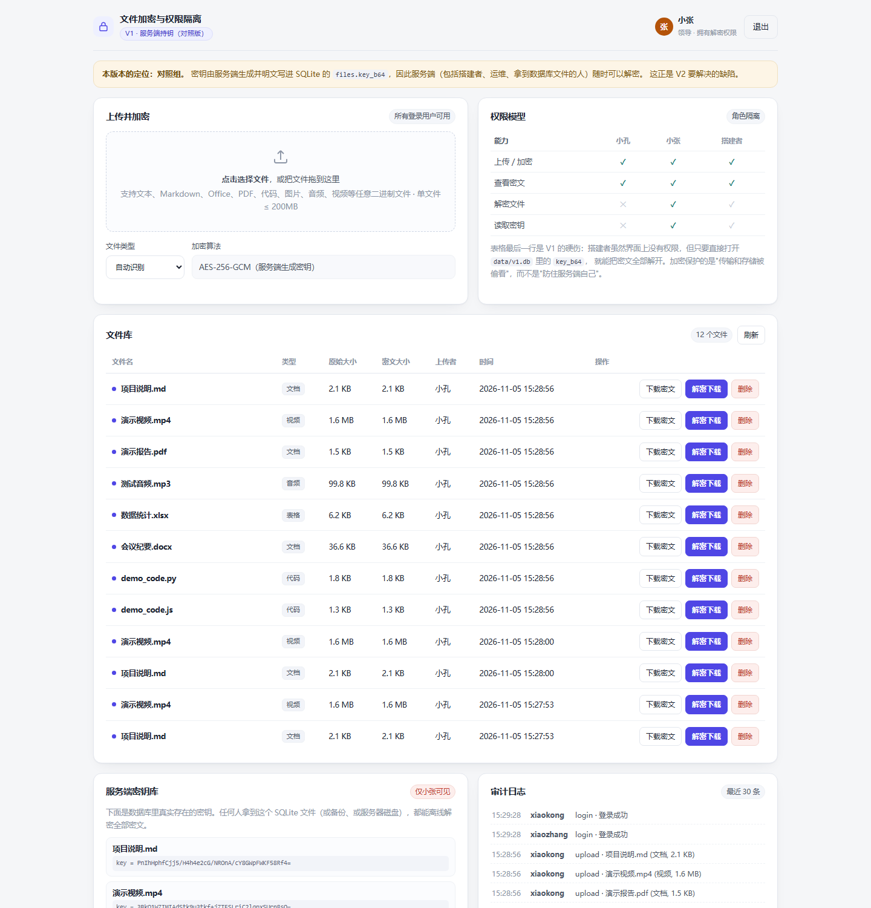

# 文件加密与权限隔离 · 双版本对照系统

一个 HTTP Web 服务（浏览器打开即用），支持对 **任意格式文件**（文本 / Markdown / Office / PDF / 代码 / 图片 / 音频 / 视频）做 AES-256 加密，并按角色隔离解密权限：

| 角色 | 职责 | 解密权限 |
| --- | --- | --- |
| 小孔 | 普通用户，上传并加密文件 | 无 |
| 小张 | 领导 / 管理员 | 有 |
| **搭建者** | 开发并部署本系统的人 | **无（硬性要求）** |

核心亮点是 **V2 版本**：搭建者即使拿到整台服务器、数据库和磁盘镜像，也解不开任何文件——因为解密密钥从头到尾没有离开过小张的浏览器。

## 两个版本

| | V1 对照版 | V2 目标版（零知识） |
| --- | --- | --- |
| 密钥由谁生成 | 服务端 | 浏览器（小张生成密钥对） |
| 密钥存放在哪 | 服务端 SQLite（`files.key_b64`） | 小张本机的密钥包文件（口令加密） |
| 搭建者能否解密 | **能**（读库即得密钥） | **不能**（库里只有公钥和被公钥封装的数据密钥） |
| 加密算法 | AES-256-GCM | AES-256-GCM + RSA-OAEP-256（信封加密） |
| 解密发生在哪 | 服务端接口 | 小张的浏览器本地（支持完全断网解密） |

V1 故意保留"服务端持钥"的常规做法，用于对照演示；V2 用信封加密消除服务端的解密能力。

## 目录结构

```
├── v1_server_key/        V1 对照版（服务端持钥）· 端口 8001
│   ├── app.py
│   └── static/           前端页面
├── v2_zero_knowledge/    V2 目标版（服务端无法解密）· 端口 8002
│   ├── app.py
│   └── static/
│       ├── crypto-core.js   全部客户端密码学逻辑（浏览器与测试共用同一份代码）
│       └── ...
├── test_files/           测试素材：md / py / js / docx / xlsx / pdf / mp3 / mp4
├── tools/                素材再生成脚本
├── tests/                端到端自动化测试与演示数据脚本
├── docs/                 技术说明 / 演示脚本 / 截图
└── requirements 说明见各子目录
```

## 快速开始

环境要求：Python 3.10+（开发验证用的是 3.13）。

跑 V2 的自动化测试还需要 **Node.js 18+**（用到内置的 Web Crypto 与 fetch，不需要 npm install 任何依赖）；只启动服务、在浏览器里操作则完全不需要 Node。

```bash
# 终端 1：V1 对照版，http://127.0.0.1:8001
cd v1_server_key
python -m pip install -r requirements.txt
python -m uvicorn app:app --host 127.0.0.1 --port 8001

# 终端 2：V2 目标版，http://127.0.0.1:8002
cd v2_zero_knowledge
python -m pip install -r requirements.txt
python -m uvicorn app:app --host 127.0.0.1 --port 8002
```

Windows 下也可以直接双击 `run_v1.bat` / `run_v2.bat`。

演示账号：

| 账号 | 密码 | 角色 |
| --- | --- | --- |
| `xiaokong` | `xiaokong123` | 小孔（只能加密） |
| `xiaozhang` | `xiaozhang123` | 小张（可解密） |

V2 首次使用：先用小张登录 → 「我的密钥包」生成密钥对 → 私钥包（口令加密）自动下载到本机 → 之后加密/解密都自动使用这对密钥。

## 上传的文件存在哪

**只存密文，原始文件从不落盘。**

| 内容 | V1 | V2 |
| --- | --- | --- |
| 密文 | `v1_server_key/data/blobs/<随机ID>.enc` | `v2_zero_knowledge/data/blobs/<随机ID>.enc` |
| 元数据 / 密钥 | `v1_server_key/data/v1.db`（含 `key_b64`） | `v2_zero_knowledge/data/v2.db`（只有公钥 + `wrapped_key_b64`） |

文件名是随机 ID（磁盘上看不出原始名），原始文件名只记在数据库；密文比原文多 16 字节 GCM 认证标签；`data/` 已加入 `.gitignore`，不进仓库也不进交付包，删掉即清空（重启自动重建）。详见 [docs/验收清单.md](docs/验收清单.md#一上传的文件存在哪里)。

## 自动化测试

```bash
# 一键验收（需先启动两个服务）
python tests/acceptance_v1.py    # V1：8 种格式往返 + 403 + 搭建者读库解密
node   tests/acceptance_v2.mjs   # V2：8 种格式往返 + 403 + 501 + 无机密字段
# Windows 也可双击 tests/run_acceptance.bat

# 更细的边界测试
python tests/e2e_v1.py     # 9 项：权限拒绝 / 加解密还原 / 搭建者读库离线解密(V1缺陷)
node tests/e2e_v2.mjs      # 10 项：信封加密全链路 / 服务端501 / 无机密字段 / 防篡改
```

V2 测试直接加载前端真实的 `crypto-core.js`（Node 内置 Web Crypto 与浏览器同一套 API），保证测的就是浏览器里跑的代码。

## 部署注意

- V2 的浏览器端加密依赖 Web Crypto API，**必须在 HTTPS（或 localhost）下运行**。公网部署时请用 Nginx / Caddy 挂 TLS，再反代到 uvicorn 端口。
- 单文件上限 200MB（可在 `app.py` 的 `MAX_UPLOAD_BYTES` 调整）。
- 数据文件在各自的 `data/` 目录，已在 `.gitignore` 排除，不会进仓库。

## 文档

- [docs/技术说明.md](docs/技术说明.md) —— 威胁模型、算法细节、为什么搭建者解不开
- [docs/演示脚本.md](docs/演示脚本.md) —— 10 分钟现场演示流程
- [docs/验收清单.md](docs/验收清单.md) —— 存储位置、一键验收、手动验收 30 项清单

## 截图

| V2 · 小张视角（本地解密 + 服务器自证） | V1 · 小张视角（服务端密钥库） |
| --- | --- |
|  |  |

## License

MIT
